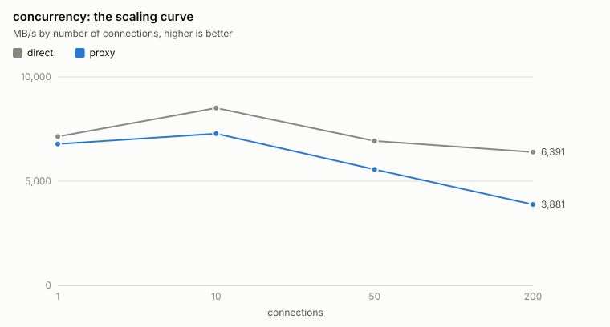
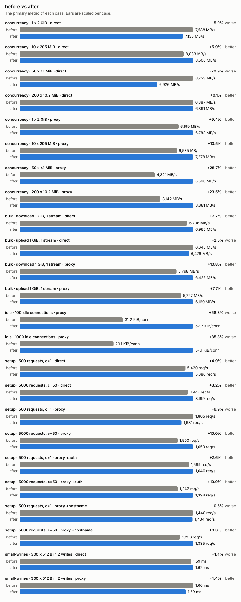
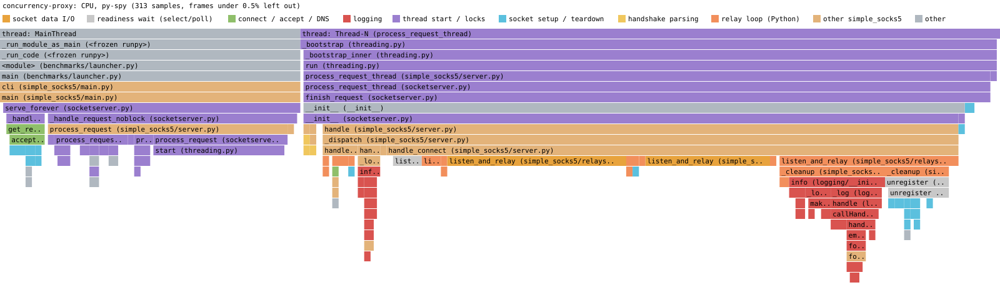
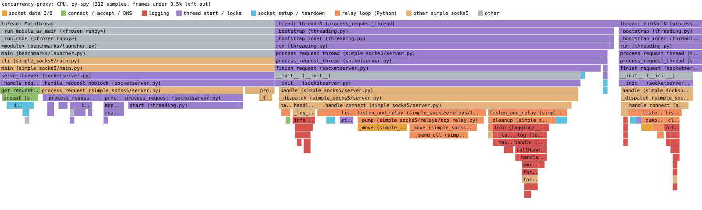

# Benchmarks

A harness that measures the proxy against direct connections to local origin servers, plus profiles of where
its time goes. It is development tooling: stdlib only, not packaged, not in the image.

## Results

### Environment

The image (Python 3.13, `-L info`) under Docker Desktop on an Apple M2 with 8 CPUs, via `run-in-docker.sh`, every
scenario with `--repeat 5` (medians). Docker Desktop's loopback is not a production host's, so read every number as
a ratio against the direct row of the same run. Every row is rerun whenever a change lands, so the table shows only
current numbers.

| Measurement | Direct | Proxy |
|---|--:|--:|
| 1 stream download / upload, MB/s | 6,983 / 6,476 | 6,425 / 6,169 |
| 10 / 50 / 200 connections, MB/s | 8,506 / 6,926 / 6,391 | 7,278 / 5,560 / 3,881 |
| Setup c=1 / c=50, req/s | 5,686 / 8,199 | 1,681 / 1,650 |
| Time to first byte p50, ms | 0.14 | 0.50 |
| Split-write round trip p50, ms | 1.62 | 1.59 |
| UDP round trips/s, 1 / 8 associations | 23,090 / 60,404 | 10,018 / 9,291 |
| Idle connection | | 54.1 KiB RSS, 2 threads, 1.1 MiB virtual |

What recent changes did, each from back-to-back runs against `main`:

- **`TCP_NODELAY` on both relay sockets.** A message written in two parts used to wait about 83 ms: Nagle's
  algorithm held the second part until the first was acknowledged, and the receiver delayed that acknowledgement.
- **Reads growing from 64 KiB to 256 KiB once one fills the buffer.** ×2.2 / ×2.3 / ×2.6 aggregate throughput at
  10 / 50 / 200 connections, +23% / +48% on one stream (download / upload).
- **A thread per relay direction, blocking in the kernel.** Each relay had one thread and a selector loop, with a
  `poll()` before every `recv()` and `send()`. Each direction now blocks in `recv()` and then `send()`, with the
  write timeout and the idle check enforced by the kernel (`SO_SNDTIMEO`, `SO_RCVTIMEO`): +12% / +16% / +31% at
  10 / 50 / 200 connections, +8–11% on one stream and +8–10% setup at c=50 (medians of three pairs); setup at c=1
  stayed within run-to-run noise. An idle connection holds two threads and 54 KiB of RSS instead of one and
  29 KiB. Threads start with a 512 KiB stack, which takes virtual size per connection from 8 MiB to 1.1 MiB, so
  200 connections still fit a 32-bit process.

Two things stand out. Aggregate throughput still falls as connections are added while direct transfers hold up,
because every relay competes for one GIL. And connection setup runs at a fifth of direct at c=50.







### Where the time goes

- **Connection setup is bound by the accept thread.** In a py-spy `--gil` profile of the setup scenario, the main
  thread holds the GIL in 57% of samples and 41% is `process_request` starting a thread per connection;
  `Thread.start` alone is 26%. Handler threads are the other 42%. Across all threads, logging is 12.5% of samples
  and socket setup and teardown 10%. Because the handler work is off the accept thread's path, turning logging off doesn't
  raise the rate (below).
- **Bulk relaying is syscall-bound.** In a py-spy CPU profile of a single stream, 98% of samples are in socket
  `send` and `recv`; the selector and the Python loop are under 2%. The GIL is released in those calls, so a `--gil` profile of a
  single stream catches almost nothing. Fewer, larger syscalls help, which is why the relay grows its reads to
  256 KiB; none in Python (`splice`) is the next step.
- **Under concurrency, threads wait for the GIL.** Proxy CPU stays at 290–360% with 10 to 200 connections while
  throughput falls by 44%: the relays queue for the GIL after each syscall. With 256 KiB reads, socket I/O went
  from 66% to 25% of GIL samples and starting threads became the largest share, 36%. With a thread per relay
  direction, the selector's 8% of GIL samples is gone, and starting threads and taking locks are 38%.
- **UDP is per-datagram Python work.** `_log_relay` formats a DEBUG line for every datagram even at INFO, 12.8% of
  GIL samples, and 8 associations reach 10.1k round trips/s against 9.6k for one.






### Ranked optimization candidates

Each was measured with a variant in [`variants.py`](variants.py), not assumed. Linux numbers; ×N is against the
proxy row of the same run.

| # | Candidate | Evidence | Expected gain | Effort | Risk | Compatible |
|--:|---|---|---|:-:|---|:-:|
| 1 | ~~`TCP_NODELAY` on both relay sockets~~ **Done** | Split-write p50 85.1 → 1.68 ms in the proxy itself; bulk, setup and concurrency within run-to-run noise | Removes a ~83 ms stall from request/response traffic | S | Low: more small packets for chatty clients | Yes |
| 2 | ~~256 KiB relay buffer instead of 64 KiB~~ **Done**, growing from 64 KiB | Single stream +23% / +48% (download / upload); ×2.2 / ×2.3 / ×2.6 at 10 / 50 / 200 connections; idle memory and setup unchanged. A fixed 256 KiB buffer cost 8–11% of the setup rate at c=1 and 2.4 KiB per lightly used connection, hence the growth | ×2.2–2.6 aggregate throughput, measured | S | Low: up to 512 KiB of buffers per busy connection, in flight only | Yes |
| 3 | `BaseRequestHandler` instead of `StreamRequestHandler` | RSS per idle connection 28.9 → 21.3 KiB (−26%); the unused `rfile` and `wfile` | A quarter less memory per connection | S | Low | Yes |
| 4 | Trim per-connection work | A `settimeout` per handshake `recv`; a second `getpeername`. The two `KeyError`s `_cleanup` raised went with the selector. About 4% of GIL samples before that | A few % setup rate | S | Low | Yes |
| 5 | Format UDP DEBUG lines lazily | `_log_relay` is 12.8% of GIL samples at INFO | ~10% UDP round trips/s | S | Low | Yes |
| 6 | ~~Two pump threads per relay, no selector~~ **Done** | +12% / +16% / +31% at 10 / 50 / 200 connections over #2, one stream +8–11%, setup at c=50 +8–10%, at c=1 within noise. The sketch's ×1.5 over #2, from one run, didn't reproduce | ×1.1–1.3 aggregate throughput, measured | M | Medium: 2 threads and 54 KiB RSS per idle connection instead of 1 and 29 KiB | Yes |
| 7 | `os.splice` on Linux, on top of #6 (the `splice` variant) | Against a 64 KiB proxy: single stream +76% at 67% CPU instead of 97%; ×4.2 / ×4.5 / ×4.3 at 10 / 50 / 200 connections | Near direct throughput on Linux | L | Medium: Linux-only path, pipes per relay, needs a fallback | Yes |
| 8 | A worker pool instead of a thread per connection | `process_request` is 41% of GIL samples during setup, `Thread.start` 26% | Higher setup rate; the accept thread is the bottleneck | M | Medium: a bounded pool changes behaviour at the connection limit | Yes |
| 9 | One forwarding socket per UDP association, reused | 8 associations: 10.1k round trips/s against 9.6k for one | UDP that scales with associations | M | Medium | Yes |
| 10 | ~~Smaller thread stack size~~ **Done**, 512 KiB with #6 | Virtual size per connection 8 MiB → 1.1 MiB; RSS unchanged | Two threads per connection need it on 32-bit arm/v7: 400 × 8 MiB is more address space than it has | S | Low: deep recursion would overflow | Yes |

**Refuted:**

- `recv_into` with a reused buffer: −4%, and on the pump threads +6% / −12% / −9% at 10 / 50 / 200 connections
  for 504 KiB per idle connection.
- Blocking sockets alone: ±5%.
- Buffers above 256 KiB: 1 MiB is erratic, from 1.9 to 6.8 GB/s across runs.
- INFO logging cost: setup at c=50 ran at 1,377 / 1,398 req/s disabled against 1,480 / 1,512 at INFO, over two runs of 7.
- Handshake round trips: inherent to the protocol, at 0.17 ms for the method reply and 0.21 ms for the CONNECT reply.
- The Python version: 3.10 is 30% slower on a single stream; 3.11 to 3.14 are flat.

### Evidence for an optimization PR

A PR that implements a candidate shows its effect with:

- a baseline run on `main` and a run on the branch, each with `bash benchmarks/run-in-docker.sh <scenario> --repeat 5`;
- `python -m benchmarks compare before.json after.json --chart before-after.svg`, with the chart in the PR body;
- a py-spy flame graph of the targeted scenario before and after, from `--profile py-spy` with
  `BENCH_PY_SPY_ARGS=--gil`.
- every row of the Results table rerun on the branch with `--repeat 5`, so it shows one current set of numbers.

## Running

From a checkout with the dev extra installed (`pip install -e '.[dev]'`):

```bash
python -m benchmarks setup                        # one scenario
python -m benchmarks bulk concurrency --candidates  # also measure each scenario's optimization candidates
python -m benchmarks all                          # every scenario, about 4 minutes without --candidates
python -m benchmarks compare old.json new.json    # primary metric of two runs side by side
python -m benchmarks compare old.json new.json --chart before-after.svg  # the same as a chart
python -m benchmarks chart results.json           # an SVG chart per scenario, next to the results file
bash benchmarks/run-in-docker.sh all              # the same, on Linux, inside the image
```

Each run prints a Markdown table per scenario and writes `results.json`, the proxy's logs and any profiles to
`benchmarks/results/<timestamp>/` (git-ignored; `--out DIR` and `--json FILE` override). Every measurement runs
three times and the median is kept (`--repeat`). Each scenario takes under two minutes, including
`--candidates`. Useful options:

| Option | Effect |
|---|---|
| `--quick` | Tiny sizes: checks the harness runs. Measures nothing. |
| `--candidates` | Adds the scenario's candidate variants (below) as extra proxy rows. |
| `--variant SPEC` | Adds a proxy row with a variant, e.g. `buf=65536` or `pumps+buf=1048576`. |
| `-L LEVEL`, `--env NAME=VALUE` | The proxy's log level (default `info`, as in the image) and extra environment. |
| `--python PATH`, `--installed` | The interpreter running the proxy; use its installed `simple_socks5` instead of `src/`. |
| `--profile KIND` | `cprofile`, `cprofile-cpu`, `sample` or `py-spy`: see [Profiling](#profiling). |
| `--tracemalloc` | Traces the proxy's allocations; the idle scenario reports KiB per connection. |

The harness starts the origin servers and the proxy as subprocesses, and drives load from four worker processes
so the client side isn't limited by one GIL. The proxy runs from `src/` with `SOCKS5_ALLOW_LOOPBACK=true` (the
origins are on loopback) and `SOCKS5_MAX_CONNECTIONS=5000`. Its log goes to a file, as a container's stdout would.
Client sockets set `TCP_NODELAY`, as curl and browsers do. POSIX only.

## Scenarios

| Scenario | Measures |
|---|---|
| `bulk` | One stream, 1 GiB download and upload: MB/s and proxy CPU. |
| `concurrency` | 2 GiB of downloads split over 1, 10, 50 and 200 connections: the scaling curve. |
| `setup` | A fresh connection per 100-byte response, 500 at c=1 and 5,000 at c=50: req/s and p50/p95/p99, plain, with username/password auth, and by hostname (`localhost`, which adds the DNS lookup). |
| `first-byte` | 300 sequential connections: time to first byte, split into TCP connect, method reply and CONNECT reply. |
| `small-writes` | 300 request/response round trips of 512 B over one connection, each message written in two parts 0.5 ms apart: the case Nagle's algorithm delays. |
| `idle` | 100 and 1,000 established idle connections: RSS, virtual size and threads per connection. |
| `udp` | 64-byte datagram round trips through a UDP association: 1 and 8 associations. |
| `logging` | `setup` (c=50) and 10 parallel downloads at `-L disabled`, `info` and `debug`, with log bytes per connection. |
| `pythons` | One stream, 50 streams and connection setup on each interpreter in `--pythons` (3.10 to 3.14 if found). |

"proxy CPU %" is the proxy's user plus system CPU time over the run's wall time, so 100% is one core.

## Variants

To measure a candidate before anyone implements it, [`variants.py`](variants.py) patches the proxy's relay inside
the benchmark's proxy process only. These are sketches made to be measured, not reviewed code.

| Variant | Change |
|---|---|
| `buf=N` | Relay reads of N bytes throughout, instead of 64 KiB growing to 256 KiB |
| `recv_into` | Each relay direction `recv_into()` a buffer reused for its life instead of `recv()` allocating each chunk |
| `splice` | Each relay direction moves data with `os.splice()` through a pipe, so it never enters Python (Linux) |
| `stack=N` | A thread stack of N bytes instead of 512 KiB |
| `no_makefile` | The connection handler without `StreamRequestHandler`'s buffered `rfile` and `wfile`, which it never uses |

## Profiling

`--profile` profiles every proxy a run starts and writes the profile, a summary (`*.txt`, `*.json`) and, for the
samplers, an SVG flame graph to the results directory.

- `cprofile`: call counts and own time per function. It measures wall-clock time, so under GIL contention a call
  is charged for the time its thread waits to get the GIL back: it shows who waits, not who works. From Python
  3.12 one profiler covers all threads and shares one call stack, so cumulative times are wrong there.
- `cprofile-cpu`: the same, timing each thread's CPU time. Exact, but needs the proxy on 3.10 or 3.11
  (`--python python3.11`) because it needs a profiler per thread.
- `sample`: a stdlib sampler of every thread's stack, 200 times a second. Wall clock: it shows where threads are,
  including blocked in `recv()`. Works anywhere without privileges.
- `py-spy`: CPU samples of every thread. Needs root on macOS, so use `run-in-docker.sh`, which grants
  `CAP_SYS_PTRACE`. `BENCH_PY_SPY_ARGS=--gil` samples only the thread holding the GIL; `--native` adds C frames.

The `.collapsed` stack files also load in [speedscope](https://www.speedscope.app/).

## Tests and coverage

`pytest -m bench` runs every scenario, the candidates and the profilers with `--quick`, in about a minute.
It is deselected by default and runs in CI as a non-blocking job, with no timing thresholds: runners are too noisy.
The harness is outside the coverage target (`--cov=simple_socks5`), because it is tooling, not the product, and
its quick run would only show that each line executes.
